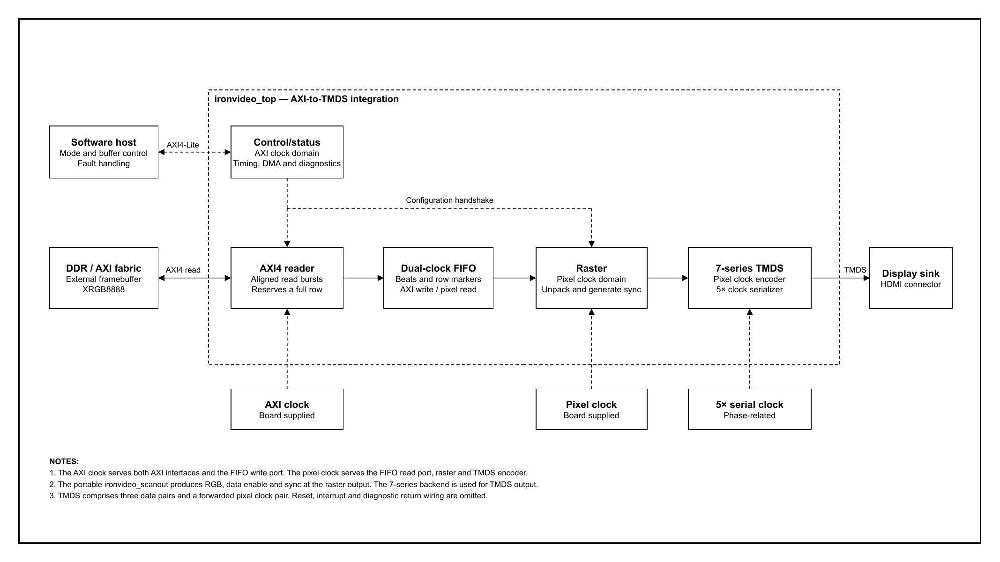
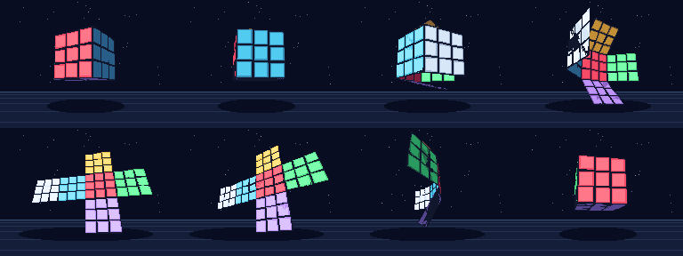

Product Brief · IronVideo

# IronVideo

FPGA framebuffer scanout over AXI, with a portable RGB raster and an AMD 7-series TMDS output.

IronVideo turns a framebuffer in DDR into a continuous progressive video stream. A CPU or graphics producer writes XRGB8888, RGB565, YUV422 (YUYV), or YUV420 (NV12) to memory. IronVideo fetches and displays them while software configures the framebuffer, timing and diagnostics over AXI4-Lite.

<strong>Working on Nexys Video.</strong> The XRGB8888 Linux platform drives a physical display at 1280 × 720, 60 Hz. Independent simulations validate complete serialized rasters at both 720p60 and 1080p60.

## Integration choices

| Entry point | Output | Where it fits |
|---|---|---|
| `ironvideo_scanout` | 24-bit RGB, data enable, horizontal sync and vertical sync | A portable SystemVerilog raster for a board with its own display transmitter |
| `ironvideo_top` | Three TMDS data pairs and one forwarded differential clock pair | AMD 7-series designs with a TMDS-capable output bank and an HDMI connector |
| Shared C driver | Bare-metal scanout, U-Boot and Linux DRM/KMS | Embedded consoles, simple graphics applications and bring-up diagnostics |

The included transmitter carries DVI-compatible video over the HDMI connector. The board supplies DDR, clock generation, reset and connector pin constraints. The three software environments share format discovery, memory validation and the register programming sequence.

## From DDR to the display

**Figure 1.** The reader fetches lines in the AXI clock domain. The dual-clock FIFO carries pixel beats and alignment markers to the raster. The 7-series backend encodes and serializes the raster for the connector.

The reader reserves room for a complete active line before fetching it. It skips stride padding and breaks requests at line and 4 KiB boundaries. The FIFO absorbs variations in DDR service while the raster continues at its externally supplied pixel clock.

| Framebuffer format | 720p60 DDR payload | 1080p60 DDR payload |
|---|---:|---:|
| XRGB8888 | 221.184 MB/s | 497.664 MB/s |
| RGB565 or YUV422 (YUYV) | 110.592 MB/s | 248.832 MB/s |
| YUV420 (NV12) | 82.944 MB/s | 186.624 MB/s |

These are average framebuffer payload rates. Budget for DDR arbitration and worst-case line service as well. The physical Nexys Video implementation uses a 128-bit read port, bursts up to 32 beats and a 16 KiB FIFO. Scanout exposes FIFO low-water, underflow and row-fetch statistics so the integrator can measure contention on the target.

## Integration and operating limits

Use AXI4-Lite to set a permitted framebuffer address window, storage stride and raster timing. Software commits a validated configuration. Fault flags and a maskable interrupt report memory-response and stream errors. The built-in test pattern exercises the raster and output without framebuffer traffic.

| Design concern | Integration requirement |
|---|---|
| Memory service | Provide an aligned 32-, 64- or 128-bit AXI4 read path. Allow for one outstanding burst and reserve sufficient DDR service under competing load. |
| Clocks and reset | Supply an AXI clock and a pixel clock. The 7-series backend also requires a phase-related clock at exactly five times the pixel clock. Keep reset asserted through clock startup. |
| Output hardware | Provide legal OSERDESE2 placement, a TMDS_33-capable bank, connector pin assignments and timing constraints. |
| Display features | The interface supports progressive RGB and YUV memory formats and DVI-compatible TMDS video. Audio, HDMI infoframes, DDC/EDID and scaling require additional logic or software. |

Set the synthesis parameter `FORMAT_MASK` to select any nonempty combination of the four native formats. The shared driver discovers the enabled formats and software selects one for scanout.

## Nexys Video bare-metal demo

The demo boots into a rotating RGB565 puzzle cube on HDMI at 1280 × 720, 60 Hz. Six hinged 3 × 3 faces unfold and close over a starfield. The 80 MHz MicroBlaze generates 128 poses at startup. During playback it writes only changed spans in a centered 384 × 288 window, updating each half after scanout passes it.

**Figure 2.** Eight poses from the demo renderer. Hardware testing measured 60 distinct frames per second over 360 frames in each format, with zero missed windows, late updates, scanout underflows or AXI faults.

### Run and control the demo

From the IronVideo repository root, run `powershell -ExecutionPolicy Bypass -File refdesign/nexys/build.ps1`. The script runs the Vivado design Tcl in `refdesign/nexys/build.tcl` and instantiates the RTL top in `hdl/ironvideo_top.v`. A full build produces `project/nexys.xpr` and `nexys-ironvideo-demo.bit` inside its output directory under `build/nexys-ref/`. Program the XC7A200T with that bitstream in Vivado Hardware Manager. It includes the MicroBlaze firmware in BRAM.

Connect HDMI OUT to the monitor and open the USB UART at **115200 8N1**. Press one key to select the scene or its framebuffer format.

| Key | Action |
|---|---|
| `C` / `B` | Show the folding cube / static color bars. |
| `A` | Cycle the color bars through all four formats. |
| `1` / `2` / `3` / `4` | Select XRGB8888 / RGB565 / YUV422 (YUYV) / YUV420 (NV12). |
| `?` | Print the menu. |

The UART reports IronVideo’s average DDR read bandwidth, peak row bandwidth and last row fetch time. In cube mode it also reports presentation rate and missed or late updates. The firmware entry point is `refdesign/nexys/main.c`.

