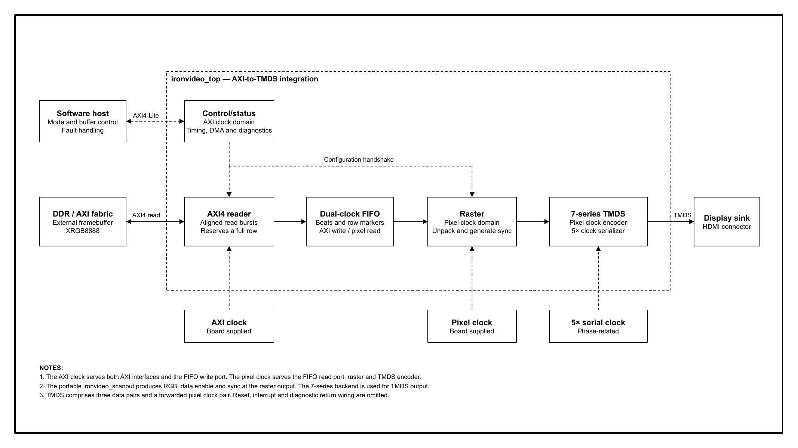

Product Brief · IronVideo

# IronVideo

FPGA framebuffer scanout over AXI, with a portable RGB raster and an AMD 7-series TMDS output.

IronVideo turns a framebuffer in DDR into a continuous progressive video stream. A CPU or graphics producer writes little-endian XRGB8888 pixels to memory. IronVideo fetches and displays them while software configures the framebuffer, timing and diagnostics over AXI4-Lite.

<strong>Working on Nexys Video.</strong> The AMD 7-series implementation drives a physical display at 1280 × 720, 60 Hz. Independent simulations validate complete serialized rasters at both 720p60 and 1080p60.

## Integration choices

| Entry point | Output | Where it fits |
|---|---|---|
| `ironvideo_scanout` | 24-bit RGB, data enable, horizontal sync and vertical sync | A portable SystemVerilog raster for a board with its own display transmitter |
| `ironvideo_top` | Three TMDS data pairs and one forwarded differential clock pair | AMD 7-series designs with a TMDS-capable output bank and an HDMI connector |
| Shared C driver | U-Boot firmware scanout and Linux DRM/KMS | Embedded consoles, simple graphics applications and bring-up diagnostics |

The included transmitter carries DVI-compatible video over the HDMI connector. The board supplies DDR, clock generation, reset and connector pin constraints. Linux and U-Boot use one driver source file and one register map.

## From DDR to the display

**Figure 1.** The reader fetches lines in the AXI clock domain. The dual-clock FIFO carries pixel beats and alignment markers to the raster. The 7-series backend encodes and serializes the raster for the connector.

The reader reserves room for a complete active line before fetching it. It skips stride padding and breaks requests at line and 4 KiB boundaries. The FIFO absorbs variations in DDR service while the raster continues at its externally supplied pixel clock.

| XRGB8888 mode | Active row | Average DDR payload |
|---|---:|---:|
| 1280 × 720 at 60 Hz | 5,120 bytes | 221 MB/s |
| 1920 × 1080 at 60 Hz | 7,680 bytes | 498 MB/s |

These are average framebuffer payload rates. Budget for DDR arbitration and worst-case line service as well. The physical Nexys Video implementation uses a 128-bit read port, bursts up to 32 beats and a 16 KiB FIFO. Scanout exposes FIFO low-water, underflow and row-fetch statistics so the integrator can measure contention on the target.

## Integration and operating limits

Use AXI4-Lite to set a permitted framebuffer address window, storage stride and raster timing. Software commits a validated configuration. Fault flags and a maskable interrupt report memory-response and stream errors. The built-in test pattern exercises the raster and output without framebuffer traffic.

| Design concern | Integration requirement |
|---|---|
| Memory service | Provide an aligned 32-, 64- or 128-bit AXI4 read path. Allow for one outstanding burst and reserve sufficient DDR service under competing load. |
| Clocks and reset | Supply an AXI clock and a pixel clock. The 7-series backend also requires a phase-related clock at exactly five times the pixel clock. Keep reset asserted through clock startup. |
| Output hardware | Provide legal OSERDESE2 placement, a TMDS_33-capable bank, connector pin assignments and timing constraints. |
| Display features | The interface supports progressive XRGB8888 and DVI-compatible TMDS video. Audio, HDMI infoframes, DDC/EDID and scaling require additional logic or software. |

IronVideo fits systems with a software-rendered framebuffer, including firmware splash screens, Linux text consoles and simple graphics. Designs with rendering, composition or windowed blits can add those functions upstream or in software. Qualify the selected mode on the target board with realistic DDR traffic and the intended display and cable.

