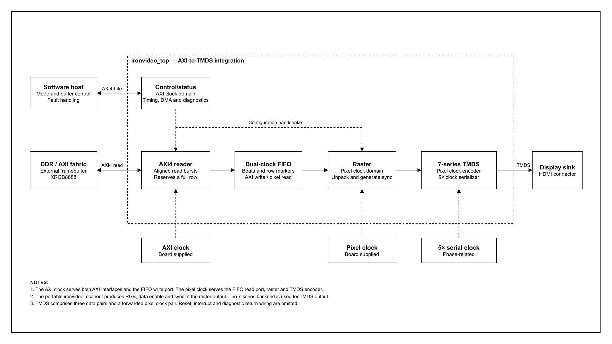

# IronVideo specification

IronVideo is an AXI4 bus master. Once configured, it reads the framebuffer from DDR on every frame without CPU intervention.

The CPU sets the framebuffer address, stride, format and display timing over
AXI4-Lite, then enables scanout. IronVideo generates the DDR read addresses,
issues burst reads and feeds the pixel FIFO. The raster produces registered
RGB, data enable, horizontal sync and vertical sync. The portable SystemVerilog
scanout can feed an external transmitter. The public `ironvideo_top` joins
the scanout with the included 7-series serializer. Firmware and Linux use
the same register map.

| Interface | Contract |
|---|---|
| Control | 32-bit AXI4-Lite, byte strobes, readable shadow state |
| Memory | Read-only AXI4 bus master, 32-bit byte addresses, 32/64/128-bit data, up to four outstanding bursts for packed formats |
| Pixel | One output pixel per active pixel clock, with format-specific memory unpacking and registered 24-bit RGB and timing outputs |
| TMDS | Three differential data pairs and one forwarded clock pair, 10-bit DDR serialization |
| Diagnostics | Sticky faults and masked interrupt, coherent raster snapshots, live row timing and request counters |
| Software | Shared portable driver for bare metal, U-Boot and Linux atomic DRM/KMS |

The core accepts software-defined progressive timings within its register,
alignment and FIFO limits. The Nexys Video reference displays 720p60. The
Zybo Z7-20 Linux reference displays XRGB8888 at 1080p60 as an engineering
mode on the tested board. Independent serialized tests cover both timings.
A board integrator supplies the memory fabric, clocks, resets,
connector pinout and constraints, and the software memory map.

## Architecture and interface selection

**Figure 1.** Control and DDR service use the AXI clock. The FIFO separates
DDR reads from the pixel raster. The 7-series transmitter uses pixel and
phase-related serializer clocks.

| Module | Responsibility |
|---|---|
| `ironvideo_top` | Public Verilog/Vivado top. Exposes the AXI interfaces, interrupt and four TMDS pairs. |
| `ironvideo_hdmi_7series` | Internal scanout and TMDS composition |
| `ironvideo_scanout` | Portable top. Implements register transactions, mode validation, fault state and cross-domain commands. |
| `ironvideo_reader` | Reserves a complete active row, schedules bursts and attaches line/frame markers. |
| `ironvideo_fifo` | Dual-clock RAM and held read beat. Bridges AXI and pixel domains. |
| `ironvideo_raster` | Advances timing and aligns FIFO data to active pixels. |
| `ironvideo_row_stats` | Times DDR row service using the pixel-domain timebase. |
| `ironvideo_tmds_7series` | Three encoders, three serialized data lanes and a forwarded clock lane |

## FPGA compatibility

The portable `ironvideo_scanout` interface supplies RGB, DE, HS and VS on
the pixel clock. It supports boards with an external parallel-input video
transmitter and FPGA families with suitable serializer outputs. The two
reference boards use the supplied AMD 7-series TMDS transmitter.

| FPGA family | Reference board or project availability |
|---|---|
| AMD Artix-7 | Nexys Video demonstrated 720p60 in all four framebuffer formats. |
| AMD Zynq-7000 | Zybo Z7-20 demonstrated 720p60 and engineering operation at 1080p60. |
| AMD Spartan-7, Kintex-7, Virtex-7 | Available for project integration. |
| AMD Kintex and Virtex UltraScale / UltraScale+, Zynq UltraScale+ MPSoC | Available for project integration. |
| AMD Versal devices with XPIO | Available for project integration. |
| Altera Cyclone 10 GX, Arria 10 | Available for project integration. |

Supported display modes depend on the selected device, speed grade and
board output circuitry. The reference sections give the measured timing
and scanout results for Nexys Video and Zybo Z7-20.

**Device references.** AMD UG471 / UG953 (7-series OSERDESE2), UG571
(UltraScale SelectIO), AM010 / PG320 (Versal XPHY), and Altera document
683520 (Arria 10 and Cyclone 10 GX LVDS SERDES IP, General Settings).

## DDR read master and FIFO

| Parameter | Default | Values |
|---|---:|---|
| `FORMAT_MASK` | 1 | Select any nonempty subset of the four formats using bits [3:0]. A value of 15 enables all four. |
| `DATA_WIDTH` | 64 | 32, 64 or 128 bits |
| `MAX_BURST` | 64 | 1–256 beats |
| `PACKED_READS` | 1 | 1–4 same-ID bursts within one row. A build that enables NV12 (`FORMAT_MASK[3]`) requires 1. |
| `FIFO_KIB` | 16 | At least 16 KiB after clamping, rounded up to a power of two, maximum 128 KiB |
| `ARQOS` | 15 | 0–15 |
| `AXI_ID_WIDTH` | 1 | Positive width. Requests use ID zero. |
| `FAMILY` | `"7SERIES"` | Public top accepts `"7SERIES"`. Other values fail at elaboration |

The public top passes `PACKED_READS` through the HDMI wrapper to the reader.
Vivado interface metadata advertises ceilings of four outstanding reads and 256 beats.
`MAX_BURST` controls actual requests. The master issues aligned, full-width
INCR reads with ARLOCK=0, ARCACHE=3 and ARPROT=0. ARSIZE is the base-2 log of
bytes per beat. ARLEN encodes beats minus one. Each request is limited by the
configured maximum, the remaining row bytes, and the next 4 KiB boundary.

The reader reserves credit for every beat of an active line before issuing its
first address. With multiple reads enabled, the reader can issue the next
address while earlier data returns. A descriptor queue tracks burst length,
address and row markers in response order. The final burst drains before
the next row starts. The
reader skips stride padding and wraps to the framebuffer base after the last
row. AR payload stays stable through ARREADY, including when stop is pending.
Packed inputs receive one beat per accepted response. The YUV420 repacker can apply R-channel backpressure while writing expanded FIFO beats. It expects ID zero,
OKAY RRESP and RLAST on the planned last beat.

FIFO depth in beats is payload bytes divided by bytes per beat. The write-side
credit counts RAM slots and conservatively delays credit for freed slots
until the synchronized read cursor arrives. Line and frame markers consume
additional storage. A held beat on the pixel side supplies pixel lanes without
depending on a simultaneous read and write of the same physical RAM location.
At 16 KiB the payload can hold two packed 1,920-pixel lines (15,360 bytes).

## Pixel timing and TMDS output

In XRGB8888 each memory pixel is little-endian `0xXXRRGGBB`. An AXI beat carries its
first pixel in bits [31:0], followed by pixels in ascending byte address
order. The high byte of each pixel is unused. The registered RGB bus is
`{R,G,B}`. DE marks the active rectangle. RGB is black during blanking.

The raster starts at the top-left active pixel and advances through active,
front porch, sync and back porch on both axes. The sync output uses the
programmed polarity during its interval and the opposite level outside it.
In pattern mode, active pixels are `R=x[7:0]`, `G=y[7:0]` and `B=R XOR G`.
Pattern scanout issues no DDR requests.

| Timing example | CTA 720p60 | CTA 1080p60 |
|---|---:|---:|
| H active / front / sync / back | 1280 / 110 / 40 / 220 | 1920 / 88 / 44 / 148 |
| V active / front / sync / back | 720 / 5 / 5 / 20 | 1080 / 4 / 5 / 36 |
| H / V totals | 1650 / 750 | 2200 / 1125 |
| HS / VS polarity | Positive / positive | Positive / positive |
| Pixel / serializer clock | 74.25 / 371.25 MHz | 148.5 / 742.5 MHz |
| Serial bit rate per data lane | 742.5 Mb/s | 1.485 Gb/s |

Supply a serializer clock at five times the pixel rate, phase-related to the
pixel clock. OSERDESE2 master/slave pairs serialize ten bits DDR per pixel,
least significant bit first. Pair lanes 0/1/2 carry blue/green/red. During
blanking, the blue lane carries the `{VS,HS}` control code and the other data
lanes carry control zero. The clock pair serializes `1111100000` LSB first and
has a falling edge at the start of a word. Differential outputs use OBUFDS.

Supply a compatible I/O bank, TMDS electrical constraints and legal
master/slave placement. Verify routed serializer timing and signal integrity.
The Zybo reference section gives the measured 1080p60 result and timing limit. The backend carries
DVI-compatible video and does not implement HDMI audio, infoframes, DDC/EDID
or interlace.

## Control, status and faults

Register addresses below are byte offsets from the mapped control base.
Use aligned 32-bit MMIO. `ironvideo_scanout` exposes 8-bit offsets. The public
Vivado top exposes 16-bit offsets and rejects nonzero upper bits. AW and W
can arrive in either order. One pending read response and one pending write
response are supported. Responses remain stable under backpressure. WSTRB
selects byte lanes. Unaligned or unimplemented addresses and writes to RO
registers return SLVERR. Reserved bits read zero.

| Offset | Register | Access | Contents |
|---|---|---|---|
| `0x00` | ID | RO | `0x49525644` |
| `0x04` | VERSION | RO | `0x00010001` for the XRGB8888-only mask. All other masks implement `0x00010002`. |
| `0x08` | CAPABILITIES | RO | [7:0] AXI data width in bits, [15:8] FIFO RAM address bits, [24:16] configured maximum burst beats, [25] clock-pair selection implemented |
| `0x0c` | CONTROL | RW | [0] requested enable, [1] shadow pattern selection, [2] commit, [3] snapshot. Command bits [3:2] read zero. |
| `0x10` | STATUS | RO | [0] a valid mode has been accepted, [1] configuration/enable transition busy, [2] applied enable, [3] quiesced, [4] snapshot busy, [5] requested enable |
| `0x14` | FAULT | W1C | [0] rejected control, [1] non-OKAY RRESP or incorrect RID, [2] unexpected matching-ID RLAST position, [3] stream lock loss |
| `0x18` | IRQ_MASK | RW | [3:0] one interrupt enable for each matching FAULT bit |
| `0x1c` | FIRST_FAULT | RO | First recorded event as a one-hot FAULT mask |
| `0x6c` | FIRST_FAULT_ADDR | RO | Address of the first DDR faulting beat, or zero for a non-DDR event |

The IRQ is active high and remains asserted while any masked sticky bit is
set. A new event wins over a simultaneous write-one-to-clear. If the first
event is cleared, the first-event latch clears unless a new event arrives
in that cycle. Outstanding sticky bits are not promoted into the first-event
latch. Simultaneous new events give priority to response/ID, RLAST, stream,
then control. Undefined register accesses return a bus error. The control
fault describes an invalid CONTROL command.

The CONTROL command and W1C bits use low-byte WSTRB. Preserve CONTROL [1:0]
when requesting a snapshot. After reset no mode is configured, the engine is
stopped, IRQ_MASK and FAULT are zero, and identity and capability fields read
as shown. Command rejection leaves the previous state in force.

## Mode and framebuffer registers

All registers on this page have RW shadow access. Readback returns the
programmed shadow fields. An accepted commit captures the mode for application
to the hardware. Timing and prefill fields use bits [15:0].

| Offset | Register | Meaning |
|---|---|---|
| `0x20` | FB_BASE | First active pixel's byte address |
| `0x24` | FB_STRIDE | Byte distance between successive active line starts |
| `0x28` | WINDOW_BASE | First allowed framebuffer DMA byte address |
| `0x2c` | WINDOW_BYTES | Size of the allowed DMA window in bytes |
| `0x30` | H_ACTIVE | Active pixels |
| `0x34` | H_FRONT | Horizontal front porch pixels |
| `0x38` | H_SYNC | Horizontal sync interval in pixels |
| `0x3c` | H_BACK | Horizontal back porch pixels |
| `0x40` | V_ACTIVE | Active lines |
| `0x44` | V_FRONT | Vertical front porch lines |
| `0x48` | V_SYNC | Vertical sync interval in lines |
| `0x4c` | V_BACK | Vertical back porch lines |
| `0x50` | POLARITY | [0] HS active high, [1] VS active high |
| `0x54` | PREFILL | Buffered beats required at initial lock and after a stream loss |

Active and sync intervals must be nonzero. Porches may be zero. Horizontal
and vertical totals must each fit 16 bits. Framebuffer mode also requires
beat alignment of base, stride and active row bytes, stride at least as
large as the active row, and room for the whole row in FIFO RAM. Prefill
must be from one through the FIFO depth in beats, within its 16-bit field. Set PREFILL to one packed row, as both drivers do.
A higher accepted value can leave the raster waiting indefinitely. For
720p with a 128-bit port and 16 KiB FIFO, three 320-beat rows fill 960
of 1,024 beats. The reader cannot reserve a fourth row, so a threshold of
1,024 prevents initial lock and the underflow count stays zero.

Validate each DMA window with wide arithmetic. For XRGB8888, let `row_bytes = 4 × H_ACTIVE`
and `frame_end = FB_BASE + (V_ACTIVE − 1) × FB_STRIDE + row_bytes`.
The window size must be nonzero, its exclusive end may be exactly `2^32`,
FB_BASE must be at or above WINDOW_BASE, and frame_end must be at or below
that exclusive end. Pattern mode uses timing and polarity only. The aperture
is a hardware bounds check. Software still owns allocation, mapping and
cache coherency.

## Native framebuffer formats

The public `FORMAT_MASK` parameter applies at elaboration to the top, scanout, reader and raster. Bit number equals the numeric format ID. For example, mask 3 builds two RGB formats and mask 12 builds the two YUV formats. Mask 1 is the legacy XRGB8888 interface. Zero and values above 15 fail elaboration. A single frame uses one selected format.

| ID and mask bit | Format | Bytes in ascending framebuffer address order | DDR bytes per frame |
|---|---|---|---:|
| 0 | XRGB8888 | B, G, R, unused, repeated | 4WH |
| 1 | RGB565 | Little-endian 16-bit word, red [15:11], green [10:5], blue [4:0] | 2WH |
| 2 | YUV422 (YUYV) | Y0, Cb, Y1, Cr for two adjacent pixels | 2WH |
| 3 | YUV420 (NV12) | Full-resolution Y plane and a second plane of alternating Cb, Cr, one pair per 2×2 luma block | 1.5WH |

RGB565 expands each component to eight bits by replicating its most significant bits into the low output bits. Both YUV formats use 8-bit BT.709 limited range, with nominal luma 16–235 and chroma 16–240. For each output pixel set `C=Y−16`, `D=Cb−128`, and `E=Cr−128`. Compute the following signed integer numerators, add 128, divide by 256 with an arithmetic right shift, and clamp each result to [0,255].

| Red | Green | Blue |
|---|---|---|
| 298C + 459E | 298C − 55D − 136E | 298C + 541D |

All YUV builds include one pipelined conversion path. The raster delays RGB bypass, pattern and timing signals alongside it. Each output remains 24-bit RGB. Chroma uses nearest-neighbor replication horizontally and vertically where subsampled.

For YUV420, even visible rows first fetch one UV row into an AXI-domain RAM. The reader fetches each Y row once, reuses the UV row for the following odd line and wraps at frame end. It writes packed YUYV into the common asynchronous FIFO. The width of both source planes is W bytes per active row. The reader reserves 2W bytes of FIFO space per displayed line. YUV422 also uses 2W FIFO bytes. XRGB8888 uses 4W and RGB565 uses 2W. Choose PREFILL as this normalized row size in AXI beats.

## Extended register interface

The VERSION register identifies the interface before software reads any extension offset. A legacy device supplies XRGB8888 through the original register set. With the extended interface, software reads FORMAT_CAPS, chooses a supported ID and writes FORMAT and any UV fields before the ordinary CONTROL commit. Changing the shadow format leaves the active mode in place until the commit succeeds.

| Offset | Register | Access | Meaning |
|---|---|---|---|
| `0x98` | FORMAT_CAPS | RO | Bits [3:0] mirror FORMAT_MASK. |
| `0x9c` | FORMAT | RW shadow | ID in bits [1:0]. Committing an unavailable ID for framebuffer scanout raises a control fault. |
| `0xa0` | UV_BASE | RW shadow | Byte address of first Cb in the YUV420 chroma plane. |
| `0xa4` | UV_STRIDE | RW shadow | Byte distance between chroma row starts. |
| `0xa8` | UV_WINDOW | RW shadow | First DMA byte address permitted for the UV plane. |
| `0xac` | UV_SIZE | RW shadow | Size of the UV aperture in bytes. |
| `0xb0` | PEAK_RATE_CYCLES | RO, clear on read | Pixel ticks for the completed row with greatest bytes per tick. Read first to close the interval and latch the associated byte count. |
| `0xb4` | PEAK_RATE_BYTES | RO | Latched byte count corresponding to the last PEAK_RATE_CYCLES read. |
| `0xb8` | CLOCK_SELECT | RW/RO | Optional when CAPS bit 25 is set. Write bit 0 to request clock pair 0 or 1. Read bit 0 for the request, bit 1 for the selected pair and bit 2 for ready. |

With `CLOCK_SELECT=1` the 7-series top accepts two constantly running,
phase-related pairs from the board MMCM. Each pair has one pixel clock and
one serializer clock at five times its frequency. Pair 0 uses `pixel_clk`
and `serial_clk`; pair 1 uses `pixel_clk_alt` and `serial_clk_alt`. The
two BUFGMUX_CTRL primitives sit inside IronVideo. Stop scanout and wait for
QUIESCED with no snapshot in progress before writing CLOCK_SELECT. The
register slave rejects changes during active scanout. The serializer stays
in reset through the switch. Ready includes feedback from both clock
domains. After it reads 4 for pair 0 or 7 for pair 1, program the new timing
and restart scanout. Fixed-clock integrations retain the original interface
behavior with `CLOCK_SELECT=0`.

Each active memory plane needs a beat-aligned base, stride and active row size. For YUV420, both dimensions are even. Validate the exclusive end of the UV aperture independently, using H/2 chroma rows. UV and Y may have different strides and may occupy separate allocations. Other formats use the primary aperture alone. Packed YUV422 requires complete pixel pairs.

In a YUV420 mode, an even numbered row transfers 2W DDR bytes and the following odd row transfers W bytes. The row timer measures each visible line separately. Use ROW_SAMPLES before and after reading ROW_LAST and ROW_BYTES to obtain a consistent current sample. The peak rate is `PEAK_RATE_BYTES × pixel_clock_hz / PEAK_RATE_CYCLES` after reading the cycle register first. Zero ticks mean no sample. ROW_BEST and ROW_WORST remain extrema of elapsed time. READ_BEATS counts actual DDR handshakes across both planes.

## Snapshot and telemetry registers

| Offset | Register | Access | Meaning |
|---|---|---|---|
| `0x58` | UNDERFLOWS | RO snapshot | Cumulative stream lock losses, modulo `2^32` |
| `0x5c` | FIFO_LOW_WATER | RO snapshot | [15:0] minimum occupancy in beats sampled at pixel consumption. Sentinel `0xffff` after mode application until consumption. |
| `0x60` | RASTER_XY | RO snapshot | Current raster counter, y [31:16] and x [15:0] |
| `0x64` | FRAMES | RO snapshot | Completed running raster frames modulo `2^32`, including black and pattern frames |
| `0x68` | UNDERFLOW_XY | RO snapshot | Latest lost pixel position, y [31:16] and x [15:0] |
| `0x70` | FIFO_CAPACITY_BYTES | RO | Rounded RAM payload capacity in bytes |
| `0x74` | DMA_STATUS | RO | [0] row fetch active, [1] ARVALID waiting for ARREADY, [2] RREADY waiting for RVALID, [3] read fault halt, [4] row-time saturation in this epoch |
| `0x78` | ROW_LAST_CYCLES | RO | Last completed row service time in pixel ticks |
| `0x7c` | ROW_BYTES | RO | DDR bytes for the last completed row. Before the first sample, the active primary row size is available. Zero before commit or in pattern mode. |
| `0x80` | ROW_SAMPLES | RO | Completed row fetches since commit, modulo `2^32` |
| `0x84` | ROW_WORST_CYCLES | RO, clear on read | Longest completed row time since this register was last read or the mode committed |
| `0x88` | ROW_BEST_CYCLES | RO, clear on read | Shortest completed row time since this register was last read or the mode committed |
| `0x8c` | READ_BEATS | RO | Accepted R beats since commit, modulo `2^32`, including discarded reads |
| `0x90` | READ_BURSTS | RO | Accepted AR requests since commit, modulo `2^32` |
| `0x94` | READ_ERRORS | RO | DDR fault events since commit, modulo `2^32`. Response and RLAST faults first reported together count once. |

Request a snapshot and wait for STATUS[4] to clear before reading the raster
group. The snapshot bank starts at zero and changes only when a request
returns. FRAMES and UNDERFLOWS accumulate until reset. Mode application
restarts the raster coordinates and the FIFO low-water interval.

Row registers are live in the AXI domain. The successful read-address
handshake for either extreme captures the old value for the read response
and clears that extreme once. A row that completes in the same AXI cycle
belongs to the next interval. Zero means no completed row sample. An
accepted mode commit resets row statistics after old DMA drains. Changing
only enable preserves the row measurement epoch.

## Mode transitions and recovery

1. **Prepare memory and clocks.** Keep AXI and pixel clocks running. Allocate
   DMA-visible memory, initialize pixels and make writes visible to the
   fabric. Select timing, polarity, framebuffer geometry and a safe window.
2. **Program and commit.** Write the shadow bank, then write CONTROL with
   the desired enable and pattern bits plus COMMIT. Validation can defer the
   AXI write response after a recent shadow write. Poll STATUS[1] until
   clear. Check STATUS[0], STATUS[2] and faults. A rejected mode returns
   SLVERR and records the control fault.
3. **Drain and apply.** An accepted commit or enable transition prevents new
   reads and drains the presented address and all accepted bursts. The AXI domain
   sends the final write cursor. The raster flushes through that cursor and
   applies the new state at the old frame boundary, or after the flush if
   stopped. Reads restart after acknowledgment. A live commit can blank part
   of the old frame and initial frames while new data accumulates.
4. **Stop or retime.** Write CONTROL with enable clear, then wait for
   QUIESCED (STATUS[3]) before freeing memory or changing clocks. For a new
   pixel rate, quiesce with both old clocks running, assert the combined
   top's reset, change clocks, wait for stability, release reset, and
   configure the new mode. A normal restart at the same rate can use the
   committed mode by setting enable.
5. **Sample diagnostics.** Write SNAPSHOT while preserving CONTROL [1:0],
   poll STATUS[4] until clear, then read the snapshot group. Serialize MMIO
   clients to keep sample ownership clear. A second snapshot while busy,
   enabling before a valid commit, or changing enable or committing during
   a configuration transition returns SLVERR.

A missing or misaligned beat loses raster stream lock once and blacks the rest
of the frame while timing continues. The raster discards data until a new
start-of-frame marker has sufficient prefill and aligns with a frame boundary.
Initial acquisition blacking does not increment UNDERFLOWS. A DDR protocol
fault suppresses framebuffer output and new requests. Inspect FAULT and
FIRST_FAULT_ADDR, correct the fault source and perform a stop/start or valid
commit. Clearing sticky bits acknowledges diagnostics. A transaction with no
matching RLAST can require a coordinated fabric reset before reuse.

## Clock-domain crossing and reset

The AXI and pixel clocks may be asynchronous. The pixel and 5× serializer
clocks must be phase-related. A common active-low reset is synchronized in
each relevant domain. Assertion is asynchronous at the synchronizers and
immediately masks AXI handshake outputs. Release takes four destination
rising edges. Local state resets on its domain clock. Run the clocks during
reset and release. Coordinate a reset during outstanding DMA with the fabric
so outstanding transfers are cancelled.

| Crossing | Mechanism | Integration check |
|---|---|---|
| FIFO write and read cursors | Registered Gray cursors, four destination synchronizer stages | Bound source-to-first-stage delay and bus skew. Preserve pointer synchronizers and their placement constraints. |
| Row timestamp and stream-loss event count | Registered 64-bit Gray pixel timer and 32-bit Gray underflow count, each through four stages | Keep consecutive Gray transitions from overlapping. Software reads the binary loss count from a snapshot. |
| Configuration, enable and final write cursor | Bundled payload held with a request toggle until return acknowledgment | Bound bundle delay to settle before receiving logic captures it after the control synchronizer. |
| Snapshot group | Pixel-domain bundle held with a return toggle until the next request | Bound reverse bundle path and preserve acknowledgment synchronizers. |
| Read fault level | Four-stage synchronized level into the raster | Preserve synchronization stages, checking reset and recovery in both domains. |

For a multi-format build, include the surviving format-select bits in the
configuration bundle's timing constraints. The NV12 chroma cache remains
entirely in the AXI clock domain. The color converter uses only the pixel clock.

The AXI domain captures the final FIFO write cursor only after the reader
idles. The raster compares that cursor to its consumption cursor and also
waits for the held beat to empty. A transient FIFO-empty indication alone
cannot complete a stop or configuration change. A normal stop preserves
shared cursor state. The FIFO RAM contents require no blanket reset.

Apply point-to-point constraints to actual crossings and review synthesized
and routed endpoints. Ensure reset release and clock relationships are
covered by implementation timing. The integrating board owns these constraints.

## Throughput and interpreting row service

Framebuffer payload demand is `width × height × refresh_hz × bytes_per_pixel`. Average bytes per pixel are 4 for XRGB8888, 2 for RGB565 or YUV422, and 1.5 for YUV420.
Raw AXI capacity is `data_width_bits / 8 × axi_clock_hz`. These quantities
bracket the problem. FPGA clocks, DRAM arbitration, read response latency,
page boundaries, short bursts and buffering determine whether a mode holds
under contention.

| XRGB8888 example at 60 Hz | Packed row | Average useful payload | Line period |
|---|---:|---:|---:|
| 1280 × 720 at 74.25 MHz | 5,120 B | 221.184 MB/s | 22.222 µs |
| 1920 × 1080 at 148.5 MHz | 7,680 B | 497.664 MB/s | 14.815 µs |

At 100 MHz, a 32-bit port has 400 MB/s raw capacity and a 128-bit port
has 1,600 MB/s. With `PACKED_READS=1`, the packed scheduler has two idle AXI cycles between bursts under
ideal request and response timing. A long sequence of full B-beat bursts
therefore has an ideal payload fraction near `B / (B + 2)`. For 32-beat
bursts this is about 94%. With multiple same-ID reads queued, consecutive bursts can return
on adjacent clocks. Use margin for DDR service gaps and monitor the FIFO
low-water and fault counters under the intended concurrent workloads.

The YUV420 repacker writes two FIFO beats per incoming Y beat. Across a
two-line group, two Y beats and one UV beat need at least five AXI clocks.
The ideal sustained DDR payload ceiling is therefore 60% of raw AXI
bandwidth before request overhead, arbitration and memory latency.

A row sample runs from the launch of the first address after row reservation through the
final successful FIFO write. It includes AR stalls, R stalls and inter-burst
gaps. Waiting for row credit and aborted rows are excluded. A synchronized
64-bit Gray pixel timer supplies both timestamps. Tick quantization is
approximately one pixel period. A completed row reports at least one tick.
Elapsed counts beyond 32 bits saturate at `0xffffffff` and set DMA_STATUS[4].

**Worked 720p60 sample.** A 5,120-byte row measured at 900 pixel ticks takes
about 12.12 µs and delivers 422.4 MB/s over that interval. It used 900/1650,
or 54.5%, of one full line period. On a 128-bit port the row transfers 320
beats. At a 100 MHz AXI clock, 320 transfer cycles occupy about 26.4% of
the 12.12 µs service window. This last figure is the reader's useful beat
occupancy for the example. It cannot reveal bus busy time for other masters
or aggregate DDR controller utilization.

## Firmware and Linux integration

### Firmware handoff

U-Boot uses the shared firmware driver. The board calls
`ironvideo_boot_scanout()` with mapped registers, reserved framebuffer
address and size, stride, display timing and XRGB8888 fill color. The helper
validates bounds and timing, drains scanout, fills and flushes the framebuffer,
commits the mode and polls scanout. The board owns memory reservation, the
address map and clock and reset setup. Use `ironvideo_boot_scanout_format()`
to select a native format with explicit per-plane layout. Retain the firmware reservation and
running clocks through the Linux takeover.

### Linux DRM/KMS

The Linux platform node uses `"ironkernel,ironvideo-v1"`, a `reg` range
covering byte `0x97` for the legacy ABI or `0xb7` for the format-selectable ABI, clocks named `"axi"` and `"pixel"`, and a native
`display-timings` mode. The driver enables and holds clock rates, verifies
the ID and ABI, and drains boot scanout before taking ownership. It checks
the mode against fixed clock rates, 16-bit timing totals, FIFO capacity,
row alignment and raw AXI capacity. Frame period is limited to 200 ms.

The driver exposes one CRTC, primary plane and DVI-compatible output.
Local linear GEM DMA buffers use the mapped device DMA address and a validated aperture for each memory plane. The driver advertises only the formats enabled in hardware. The plane covers the full mode and
accepts the framebuffer offset subject to address and alignment checks.
Display events complete in software. A framebuffer change can blank the
display. Fbdev emulation can supply the text console. Buffer memory and
clocks stay live after a drain failure until safe recovery.

The `row_stats` sysfs attribute serializes diagnostics against modesets.
It reads best and worst extrema independently and reports the sample
counter before and after those reads. A changed counter identifies a row
completion between the sample boundaries. `current_bytes_per_sec` uses the
last row. For the extended ABI, `peak_bytes_per_sec` uses the matched peak byte and tick pair. The driver field
`worst_row_budget_permille` reports longest row ticks relative to the full
horizontal period. The driver masks the hardware fault IRQ and reads
status through MMIO. A platform that handles the IRQ directly can enable
selected bits in IRQ_MASK.

## Nexys Video reference · bare-metal MicroBlaze

The Nexys Video reference design connects the MicroBlaze processor and the independent 128-bit IronVideo reader to DDR3. The reference CPU and 128-bit AXI fabric run at 80 MHz. The MIG receives separate 100 MHz input and 200 MHz reference clocks. BRAM contains the reset vectors and firmware. UARTLite provides scene and format controls and reports scanout measurements. The reference enables `FORMAT_MASK=15` and supplies the 74.25 MHz pixel clock and phase-related 371.25 MHz serializer clock for 1280 × 720 at 60 Hz.

Bare-metal firmware, Linux and U-Boot share the routines for device discovery, mode validation and scanout control. The UART menu selects the folding cube (C), static bars (B), a native format (1–4), or help (?). The selected format stays active until another format is chosen. The CPU generates 128 indexed poses, magnifies the 192 × 144 scene by two and caches the changed pixel spans. During playback, it writes each half of the window after scanout passes it. UART reports average scanout bandwidth, peak row service rate, last row time in microseconds, FIFO low-water and animation deadlines.

| 720p60 format | Primary row | UV row | Scanout payload | Longest measured CPU update |
|---|---:|---:|---:|---:|
| XRGB8888 | 5,120 bytes | — | 221.184 MB/s | 11.20 ms |
| RGB565 | 2,560 bytes | — | 110.592 MB/s | 6.62 ms |
| YUV422 (YUYV) | 2,560 bytes | — | 110.592 MB/s | 6.60 ms |
| YUV420 (NV12) | 1,280 bytes | 1,280 bytes per two lines | 82.944 MB/s | 8.42 ms |

The physical board presented 60.000 distinct animation frames per second over 360 frames in each format, with zero missed windows, late updates, underflows or AXI errors. CPU update times sum the two write intervals. Scanout payload counts only IronVideo reads in decimal MB/s.

The routed all-format reference uses 15,131 LUTs, 16,601 flip-flops, 22 block RAM tiles and 10 DSPs across the complete design. Its timing report gives +0.534 ns setup slack and +0.012 ns hold slack. UpdateMEM embeds the firmware into processor BRAM in the deliverable bitstream.

Physical output on the Nexys reference is limited to 720p60. The generic core verification includes 1080p60 simulation. Its 742.5 MHz serializer clock exceeds the rated clock network speed of the Nexys Artix-7 −1 part.

## Nexys Video demo · folding cube and color bars

Connect HDMI OUT to a 720p60 display and open the USB UART at 115200 baud,
8N1. The demo starts with the folding cube in RGB565. Press `C` for the cube
or `B` for the bars. Keys `1` through `4` select XRGB8888, RGB565, YUYV
and NV12 respectively. Press `?` to display the menu.

**Figure 2.** Eight poses from the bare-metal demo renderer. The MicroBlaze
animates a centered 384 × 288 window within the 1280 × 720 raster.

**Figure 3.** The static test screen reverses the bar order in the bottom
quarter. Switching formats keeps the pattern in place for visual comparison.

## Zybo Z7-20 reference · Linux on Zynq-7000

On the Digilent Zybo Z7-20, Linux on the Zynq-7000 Cortex-A9 owns the DRM
framebuffer in PS DDR. IronVideo reads it through the 64-bit HP0 port.
The tested 1080p60 profile uses a 148.5 MHz AXI clock, 16-beat bursts,
`PACKED_READS=4`, `ARQOS=15` and a 16 KiB FIFO. It enables XRGB8888,
RGB565 and YUYV (`FORMAT_MASK=7`). Audio DMA uses HP1 and capture uses HP2.

U-Boot can select `HDMI=1080p60` (default) or `720p60` and display the
internal coordinate pattern before Linux starts. Linux takes over with a
DDR-backed console and mirrors serial output to VT1. The standalone
`ironforge-cube --mute` application draws into cached RAM, copies the
changed rectangle to the active DRM buffer and restores the console on exit.

**Figure 4.** Native 1920 × 1080 XRGB8888 pixels read back from the active
Zybo framebuffer during the muted demo. The camera was idle.

| Physical measurement | Result |
|---|---|
| Linux console, four reads in flight | 4,204 raster frames in 70.07 s. Zero underruns, AXI read errors or faults. FIFO minimum 1,030 of 2,048 beats. |
| DDR row service | Peak 1.158 GB/s. Longest measured row took 1,220 pixel clocks out of 2,200 per line. With one read in flight the earlier build recorded 1,892 underruns in 63.05 s. |
| Cube, ARM temporarily at 333.33 MHz on USB power | 22.71 rendered frames/s over 12.023 s. Within one scanout epoch HDMI advanced 484 raster frames in 8.06 s (60.05 Hz), with zero underruns, read errors or faults. |

The AXI domain closed setup/hold at +0.414/+0.052 ns. The 742.5 MHz
serializer exceeded the XC7Z020-1 clock-network rating and missed the
pulse-width check by 0.320 ns. The physical 1080p60 result applies to this
board and monitor.

## Verification and bring-up

| Regression | Checks |
|---|---|
| Portable scanout | Independent framebuffer and raster comparison at 32, 64 and 128 bits |
| AXI reader limits | Burst caps of 1, 64 and 256, FIFO credit stalls and page boundaries |
| Packed read queue | Overlapping same-ID requests, ordered data and markers, stalled address, stop/drain and response faults |
| Row telemetry | Independent clocks, delayed DDR responses, aborts, extrema reads, backpressure and completion races |
| Native formats | All 15 masks, live switching, per-plane apertures, NV12 chroma reuse and peak service rate |
| Full-frame RGB | 720p60 startup and DDR-backed pixels with modeled arbitration and response stalls |
| TMDS encoder and backend | All byte values at reachable disparities, differential polarity, lane order and forwarded clock |
| Public AXI-to-TMDS top | AXI-Lite address handling, framebuffer DDR reads and decoded colors. Unsupported family elaboration is rejected. |
| Serialized full frames | Independent 720p60 and 1080p60 pin receivers check timing and decoded pixels. The reversed-clock control expects rejection at the first pixel. |

XSim uses the UNISIM and SecureIP libraries. Active-HDL uses the
installed OSERDESE2 and OBUFDS models and a shared independent TMDS receiver.

For a new board, check IP identity and capabilities, verify clocks and reset
release, and start with the internal pattern. Commit a known DDR image and
check scanout, output polarity and orientation. Sample row service and
faults under representative DDR traffic. Exercise stop/drain, restart and
firmware-to-Linux handoff before releasing memory. Physical mode support
depends on the routed design and the attached display.

