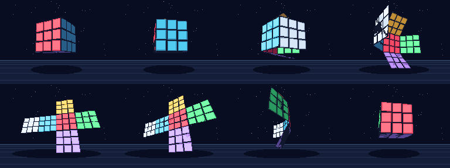
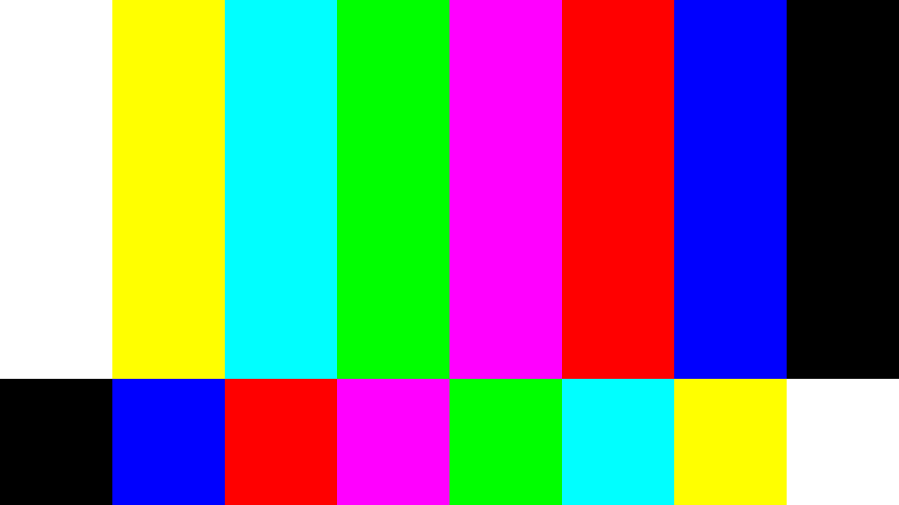

# Nexys Video bare-metal reference design

This standalone example targets the Nexys Video rev A and its XC7A200T-1
Artix-7. It builds a BRAM-bootable FPGA image with a cacheless MicroBlaze,
the board’s DDR3 MIG, UARTLite and IronVideo. It needs no operating system,
Vitis BSP, or IronForge workspace.

## Build on Windows

Install AMD Vivado and the AMD bare-metal MicroBlaze GCC toolchain. The build
uses Vivado, UpdateMEM and `mb-gcc` from the same AMD installation. From the
IronVideo checkout, run:

```powershell
powershell.exe -NoProfile -ExecutionPolicy Bypass -File refdesign/nexys/build.ps1
```

Use `-AmdRoot` for a non-default installation, `-Stage firmware` for just
the executable, and `-Stage generate` to validate the Vivado block design
without routing. The default build compiles the firmware, routes the design,
checks timing and CDC, and inserts the ELF into the routed bitstream. Each
invocation uses a separate folder under `build/nexys-ref/`. The complete
image is `nexys-ironvideo-demo.bit`. The receipt records the actual input,
tool and output hashes.

For a firmware iteration, reuse a passing hardware route from this checkout.
The embed stage verifies the routed FPGA image, memory map, hardware sources
and timing reports before inserting the new MicroBlaze executable.

```powershell
.\refdesign\nexys\build.ps1 -Stage embed -RouteReceipt <path-to-routed-receipt.json>
```

In Vivado Hardware Manager, program the Nexys Video XC7A200T with
`nexys-ironvideo-demo.bit`. Processor BRAM boots the demonstration on
configuration. Connect a terminal to the board's USB UART for the menu.

The first hardware build fetches Digilent's Nexys Video rev A board MIG
project from the immutable `vivado-boards` revision
`d8d43ed9f3f7e367ee3de82782ed601d88305677`. The build script pins the exact
URL and SHA-256. Use `-Offline` for a verified cached file or
`-MigPrj <path>` to supply an existing copy with that hash. The original
MIG project is a Digilent input. The build derives the 128-bit AXI and
unbuffered system clock configuration in its output folder. AMD distributes
the generated MIG and MicroBlaze infrastructure under its tool and IP terms.

The reference example source is GPL-2.0-only, as identified in its source
headers. It instantiates the canonical `hdl/` modules and uses the same
portable register driver as the Linux adapter.

## Demonstration

UART runs at **115200 8N1**. The demo uses fixed **1280 × 720 at 60 Hz**
and can write XRGB8888, RGB565, YUV422 (YUYV) and YUV420 (NV12) directly
to DDR. YUV uses limited-range BT.709, with a separate interleaved UV
plane for NV12. Power-up selects the cube in RGB565. Commands act on a
single keystroke.

| Key | Action |
|---|---|
| C | Show the rotating and folding cube. |
| B | Show static color bars. The lower quarter reverses the order. |
| A | Show color bars and cycle through all four formats, two seconds per measurement. |
| 1–4 | Select XRGB8888, RGB565, YUV422 or YUV420 respectively. |
| ? | Print the menu. |

The cube renderer uses fixed-point transforms and perspective to show six
hinged 3 × 3 panels. Firmware magnifies the 192 × 144 indexed scene by
two and presents a 384 × 288 window in the center of the raster. At startup,
the MicroBlaze generates 128 poses and records the spans that change between
successive poses. The same cache works with each framebuffer format. During
playback the CPU writes those spans to the framebuffer in two horizontal
bands, after scanout has passed each band. IronVideo fetches the native
pixels from DDR throughout the animation.
The image below shows assembled, partially folded and open phases.





On format changes, firmware drains scanout before rewriting DDR and uses
the common driver to validate and commit the new settings. UART reports
average read payload, peak row service rate, latest row time, FIFO low-water
and scanout status. In cube mode the UART also reports the number of poses
presented per second, missed presentation opportunities, updates that
finished within the 32-line prefetch allowance or later, and the longest
update in raster-line periods. One line lasts 22.22 µs at 720p60.
Expected active payload at 720p60 is 221.184 MB/s for
XRGB8888, 110.592 MB/s for RGB565 and YUV422, and 82.944 MB/s for YUV420.
These figures count scanout reads. CPU rendering and DDR writes also use
the memory system.

On the physical Nexys the cube sustained 60.000 distinct phases per second
for 360 measured frames in each format. Every presentation window and band
deadline was met, with zero underflows and read faults. The longest measured
CPU update was 6.62 ms for RGB565, 6.60 ms for YUYV, 8.42 ms for NV12
and 11.20 ms for XRGB8888 within the 16.67 ms frame period.

The CPU and AXI fabric run at 80 MHz. The design also uses separate 100 MHz
and 200 MHz MIG input clocks, a 74.25 MHz pixel clock and a phase-related
371.25 MHz serializer clock. The reference design supports up to 720p60.

## Host cube regression

From this directory, compile with a host C11 compiler and run the test.

```sh
mkdir -p ../../build
cc -std=c11 -O2 -Wall -Wextra -Werror cube.c test_cube.c -o ../../build/test_cube
../../build/test_cube
```

Pass an output file path as the first argument to write a PPM montage
from the same renderer.

The animation write-path regression requires a 64-bit little-endian host
and reserves two mappings at the reference design's DDR scratch addresses.
It builds the span cache once and tests all four native output formats.

```sh
cc -std=c11 -O2 -Wall -Wextra -Werror -I ../../driver cube.c animation.c test_animation.c -o ../../build/test_animation
../../build/test_animation
```
